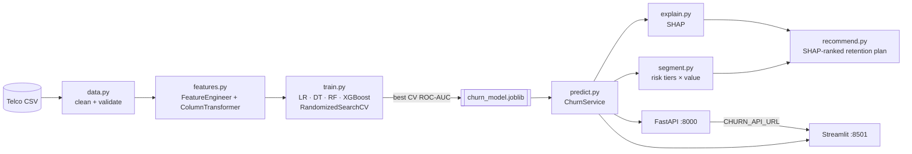
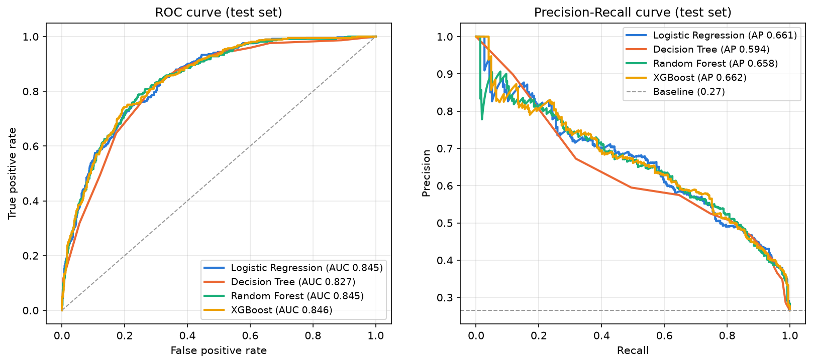
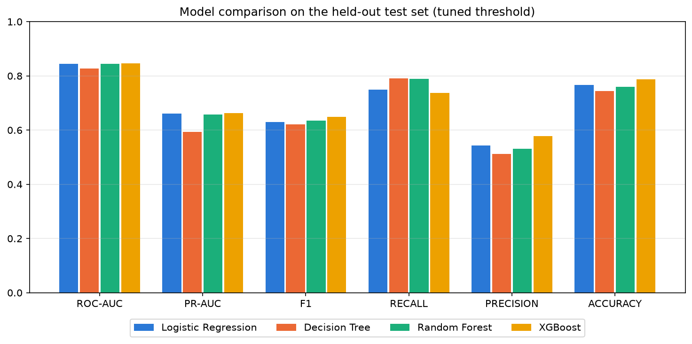
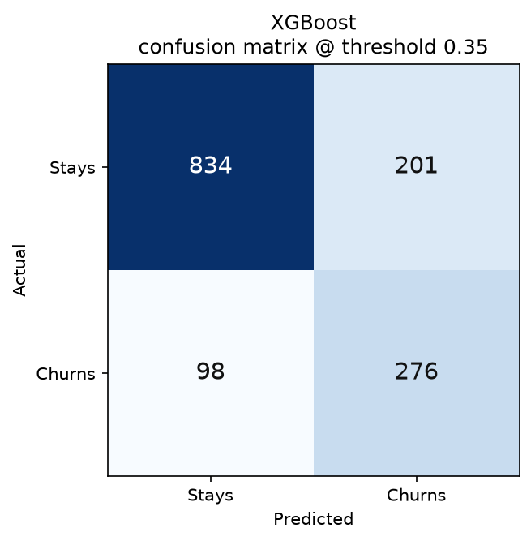
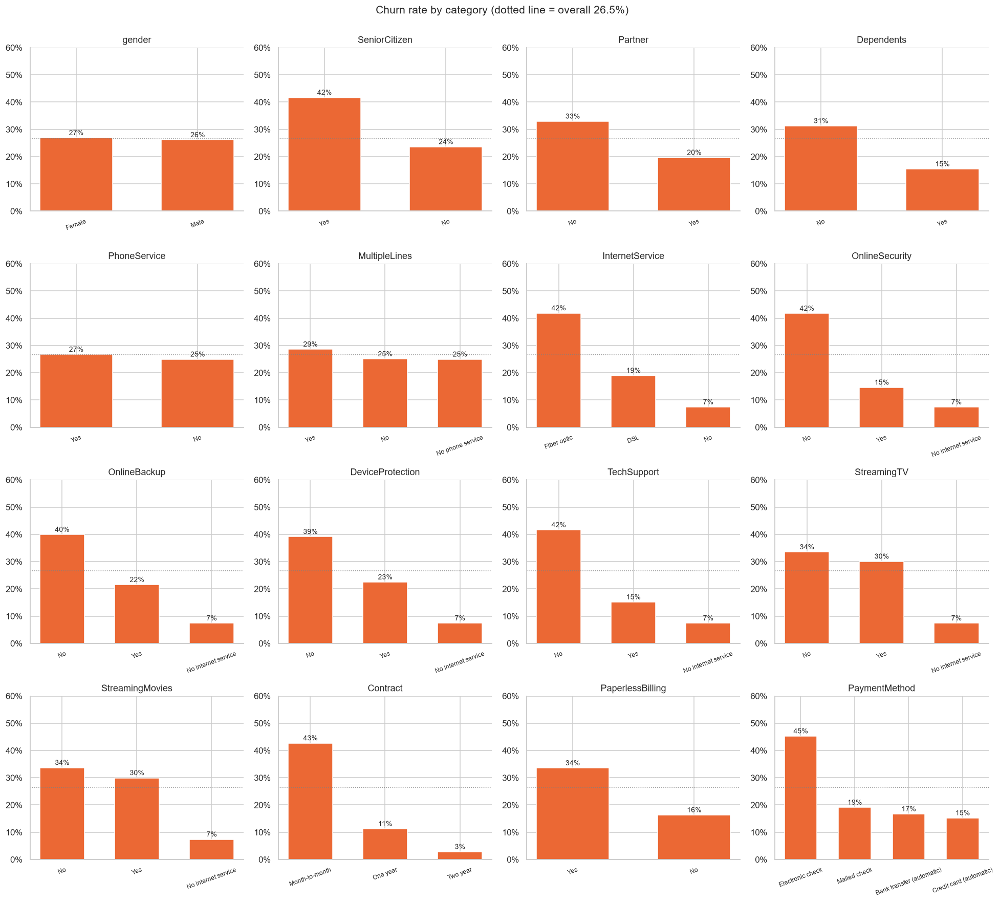
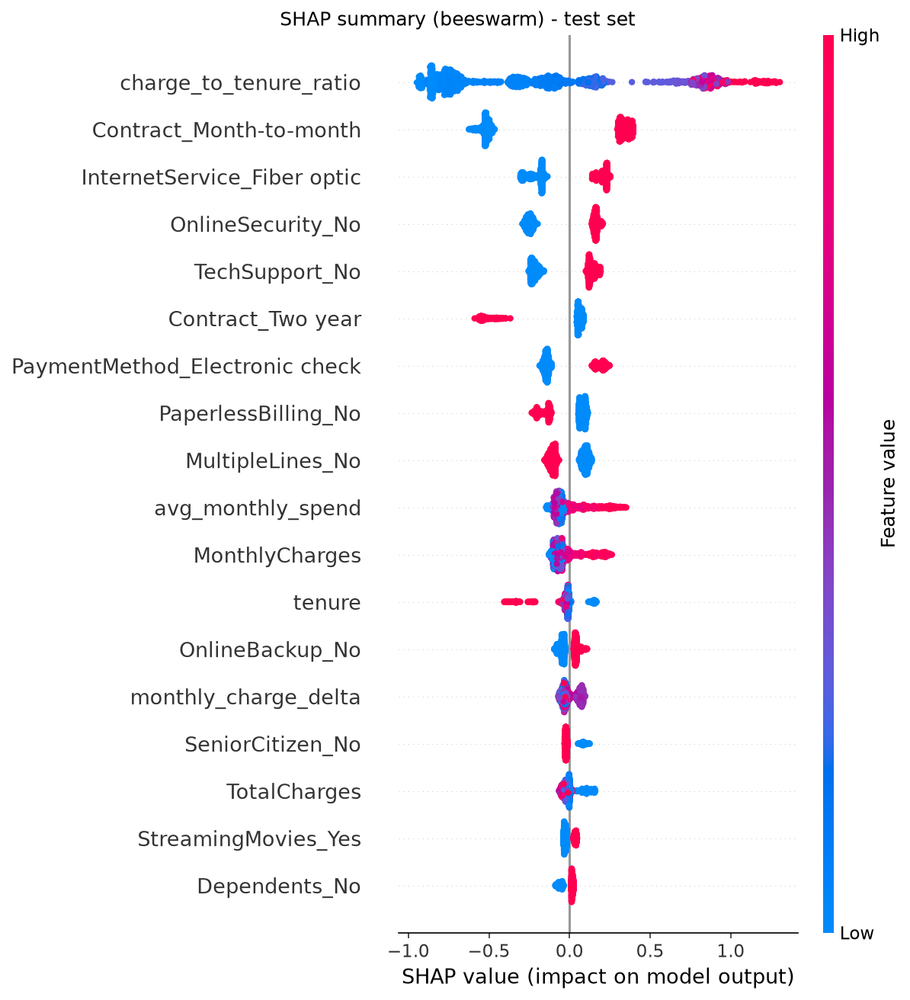
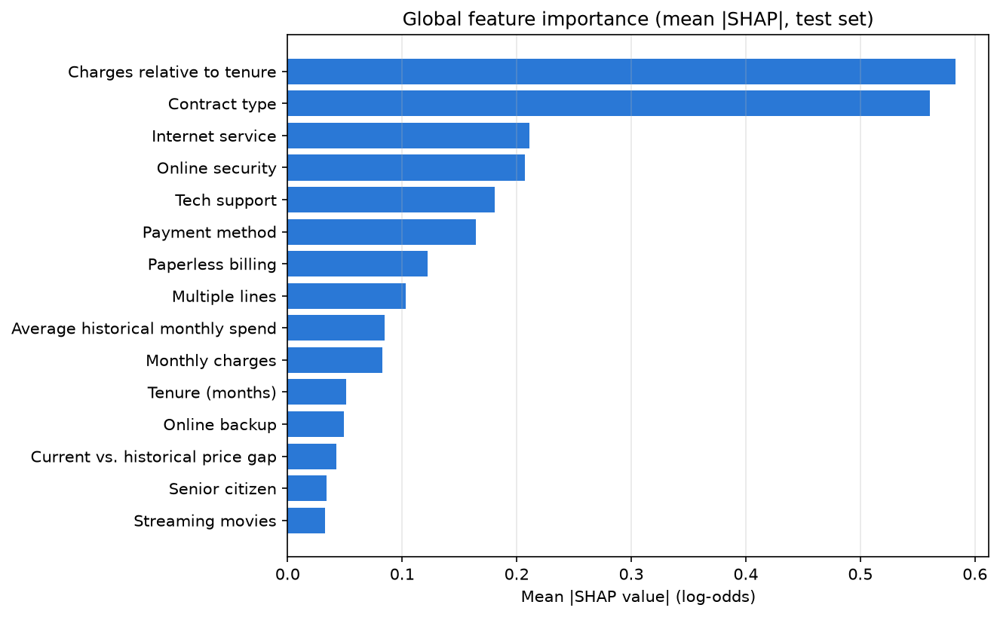

<div align="center">

# 📉 Intelligent Customer Churn Prediction System

**Predict which customers will leave, explain why, and tell the business what to do about it.**

[](https://github.com/MohamedAkramOkasha/Intelligent-Customer-Churn-Prediction-System/actions/workflows/ci.yml)
[](https://www.python.org/)
[](https://scikit-learn.org/)
[](https://xgboost.ai/)
[](https://shap.readthedocs.io/)
[](https://fastapi.tiangolo.com/)
[](https://streamlit.io/)
[](https://www.docker.com/)
[](LICENSE)

</div>

---

## Overview

Acquiring a new telecom customer costs several times more than keeping an existing one. This
project is an end-to-end churn system built on the
[IBM Telco Customer Churn dataset](https://github.com/IBM/telco-customer-churn-on-icp4d)
(7,043 customers, 26.5% churn). It covers the full path from raw data to action:

| Stage | What it does |
|---|---|
| **EDA** | Data-quality audit, churn drivers, interaction effects ([notebook](notebooks/01_eda.ipynb)) |
| **Preprocessing & feature engineering** | Cleaning + 8 behavioural features inside one scikit-learn `Pipeline` |
| **Modelling** | Logistic Regression, Decision Tree, Random Forest and XGBoost, tuned with 5-fold CV and compared on a held-out test set |
| **Explainability** | SHAP, global and per customer, with one-hot columns folded back into readable features |
| **Risk segmentation** | 4 risk tiers × customer value → 4 actionable segments with revenue at risk |
| **Retention recommendations** | Personalised actions ranked by *each customer's own* SHAP churn drivers, with campaign economics |
| **Deployment** | FastAPI REST service, 6-page Streamlit dashboard, Docker Compose, GitHub Actions CI |

## Architecture



`ChurnService` is the single inference entry point, so the API and the dashboard always
produce identical predictions, explanations and recommendations.

## Results

All models were tuned on the training set (5,634 customers) with 5-fold stratified CV and
evaluated once on the held-out test set (1,409 customers). Metrics use each model's
**F1-optimised threshold**, chosen on out-of-fold training predictions (never on the test set).

| Model | CV ROC-AUC | Test ROC-AUC | PR-AUC | Recall | Precision | F1 | Accuracy |
|---|---|---|---|---|---|---|---|
| **XGBoost** ⭐ | **0.851** ± 0.012 | **0.846** | **0.662** | 0.738 | **0.579** | **0.649** | **0.788** |
| Logistic Regression | 0.847 ± 0.011 | 0.845 | 0.661 | 0.749 | 0.543 | 0.629 | 0.766 |
| Random Forest | 0.847 ± 0.010 | 0.845 | 0.658 | 0.789 | 0.532 | 0.635 | 0.759 |
| Decision Tree | 0.830 ± 0.012 | 0.827 | 0.594 | 0.791 | 0.511 | 0.621 | 0.744 |

**Production model: XGBoost.** It catches **74% of churners**, and contacting only the riskiest
20% of customers reaches **50% of all churners** (2.5× random targeting).

> **An honest note on the comparison:** XGBoost, Logistic Regression and Random Forest are
> within one CV standard deviation of each other. This is typical for this dataset, whose
> published results cluster around 0.84-0.86 ROC-AUC. XGBoost is kept because it is best on
> CV, precision, F1 and accuracy, but a regulated setting could reasonably choose the logistic
> model for its simplicity at almost no cost in accuracy.

<p align="center">
  
</p>
<p align="center">
  
  
</p>

## Key insights

<p align="center">
  
</p>

| Driver | Highest-risk group | Churn | Lowest-risk group | Churn |
|---|---|---|---|---|
| Contract | Month-to-month | **43%** | Two year | 3% |
| Payment method | Electronic check | **45%** | Credit card (automatic) | 15% |
| Internet service | Fiber optic | **42%** | No internet | 7% |
| Tech support | No | **42%** | Yes | 15% |
| Tenure | First 12 months | **47%** | After 12 months | 17% |
| Senior citizen | Yes | **42%** | No | 24% |

- Risk compounds: **month-to-month fiber customers churn at ~55%**.
- `gender` and `PhoneService` carry essentially no signal (Cramér's V ≈ 0.01).
- 11 customers have blank `TotalCharges`. All have tenure 0 (not yet billed), so they are set
  to 0 rather than mean-imputed.

## Explainability (SHAP)

<p align="center">
  
  
</p>

- **Exact SHAP values** for every model type: `TreeExplainer` for XGBoost/RF/DT and
  `LinearExplainer` for logistic regression. A unit test checks additivity: base value plus the
  sum of SHAP values reproduces the model output to within 1e-4.
- **Readable explanations:** one-hot columns are summed back into their source feature, so the
  API returns `Contract type = Month-to-month (+0.43)` instead of three dummy columns.
- The engineered **`charge_to_tenure_ratio`** (expensive *and* new) is the strongest
  single driver, ahead of contract type.

## Risk segmentation

Each customer gets a **risk tier** from their churn probability and a **value flag** (monthly
charges ≥ training median, $70.50). Together these give four segments:

| | **High value** | **Lower value** |
|---|---|---|
| **High / Critical risk** (p ≥ 0.50) | 🔴 **Priority Rescue**: personal outreach within 48h, strongest offers | 🟠 **Cost-Efficient Save**: automated, low-cost plays |
| **Low / Medium risk** (p < 0.50) | 🔵 **Loyal VIP - Nurture**: loyalty perks, proactive service | 🟢 **Stable - Grow**: upsell & cross-sell |

Every customer also gets an **expected annual revenue at risk** = `p(churn) × monthly charges × 12`.
Across the full base, the 1,096 *Priority Rescue* customers alone account for **~$778K** of it.

## Personalised retention recommendations

`recommend.py` holds 11 retention interventions (contract migration, autopay incentive, tech-support
trial, security bundle, early-life care, plan right-sizing, price lock, fiber quality check, and more).
For each customer:

1. **Eligibility:** only actions that make sense for the profile are considered. A two-year
   autopay customer is never offered a contract upgrade or an autopay credit.
2. **Ranking:** eligible actions are ranked by the **positive SHAP contribution of the features
   they address**, so the top action targets *this* customer's real churn drivers.
3. **Intensity by tier:** Critical gets up to 4 actions, a 48h SLA and up to 25% discount
   authority; Low gets 1 light-touch action.
4. **Economics:** revenue at risk, estimated campaign cost and the **break-even save rate**.

The dashboard's **Retention planner** adds a campaign ROI simulator (choose target tiers, save
rate and cost per contact) and an exportable priority call list.

## Quick start

### Option A: Docker (recommended)

```bash
git clone https://github.com/MohamedAkramOkasha/Intelligent-Customer-Churn-Prediction-System.git
cd Intelligent-Customer-Churn-Prediction-System
```

```bash
docker compose up --build
```

| Service | URL |
|---|---|
| Streamlit dashboard | http://localhost:8501 |
| FastAPI (Swagger UI) | http://localhost:8000/docs |

The dashboard calls the API over the compose network (`CHURN_API_URL=http://api:8000`). The
image trains the model during the build if `models/churn_model.joblib` is missing.

### Option B: Local

```bash
git clone https://github.com/MohamedAkramOkasha/Intelligent-Customer-Churn-Prediction-System.git
cd Intelligent-Customer-Churn-Prediction-System

python -m venv .venv && source .venv/bin/activate   # Windows: .venv\Scripts\activate
pip install -r requirements-dev.txt

export PYTHONPATH=src            # Windows PowerShell: $env:PYTHONPATH="src"
python -m churn.train            # ~2.5 min full search (or --fast for ~40 s)
uvicorn api.main:app --reload    # http://localhost:8000/docs
streamlit run dashboard/app.py   # http://localhost:8501
```

A `Makefile` wraps these: `make train`, `make api`, `make dashboard`, `make test`, `make docker-up`.

## API

| Method | Endpoint | Description |
|---|---|---|
| `GET` | `/health` | Liveness + model-loaded check |
| `GET` | `/model/info` | Model name, threshold, test metrics |
| `GET` | `/model/feature-importance?top_n=15` | Global mean \|SHAP\| ranking |
| `POST` | `/predict?explain=true` | One customer → probability, tier, segment, SHAP drivers, retention plan |
| `POST` | `/predict/batch` | Up to 5,000 customers, with portfolio summary |

```bash
curl -X POST http://localhost:8000/predict -H "Content-Type: application/json" -d '{
  "customerID": "DEMO-001", "gender": "Female", "SeniorCitizen": "No", "Partner": "No",
  "Dependents": "No", "tenure": 3, "PhoneService": "Yes", "MultipleLines": "No",
  "InternetService": "Fiber optic", "OnlineSecurity": "No", "OnlineBackup": "No",
  "DeviceProtection": "No", "TechSupport": "No", "StreamingTV": "Yes", "StreamingMovies": "No",
  "Contract": "Month-to-month", "PaperlessBilling": "Yes", "PaymentMethod": "Electronic check",
  "MonthlyCharges": 89.1, "TotalCharges": 265.3}'
```

<details>
<summary>Example response (abridged)</summary>

```json
{
  "customerID": "DEMO-001",
  "churn_probability": 0.7506,
  "will_churn": true,
  "risk_tier": "Critical",
  "segment": "Priority Rescue",
  "segment_description": "High churn risk and high revenue. Act within 48 hours with a personal outreach and the strongest offers.",
  "top_drivers": [
    {
      "feature": "charge_to_tenure_ratio",
      "label": "Charges relative to tenure",
      "value": 22.27,
      "shap_value": 0.8995,
      "direction": "increases churn risk"
    },
    {
      "feature": "Contract",
      "label": "Contract type",
      "value": "Month-to-month",
      "shap_value": 0.4317,
      "direction": "increases churn risk"
    },
    {
      "feature": "InternetService",
      "label": "Internet service",
      "value": "Fiber optic",
      "shap_value": 0.233,
      "direction": "increases churn risk"
    },
    {
      "feature": "OnlineSecurity",
      "label": "Online security",
      "value": "No",
      "shap_value": 0.1628,
      "direction": "increases churn risk"
    }
  ],
  "retention_plan": {
    "playbook": {
      "sla": "Contact within 48 hours",
      "owner": "Senior retention specialist",
      "max_discount_pct": 25,
      "summary": "Personal call with a tailored package; authorised to combine offers."
    },
    "recommendations": [
      {
        "rank": 1,
        "title": "Early-life onboarding programme",
        "action": "Enrol in the first-year care programme: 30/60/90-day check-ins, setup help and a dedicated contact.",
        "priority": "High",
        "channel": "Customer success manager",
        "driver_impact": 0.9013
      },
      {
        "rank": 2,
        "title": "Migrate to a 12-month contract",
        "action": "Offer a 12-month contract with a 15% discount for the first 3 months and a price-lock guarantee.",
        "priority": "Medium",
        "channel": "Retention call / in-app offer",
        "driver_impact": 0.4335
      },
      "..."
    ],
    "economics": {
      "annual_revenue_at_risk": 802.53,
      "est_campaign_cost": 53.55,
      "break_even_save_rate": 0.067
    }
  }
}
```
</details>

Inputs are validated by Pydantic: unknown categories, negative charges or missing fields return
`422`. `SeniorCitizen` accepts both `"Yes"/"No"` and the dataset's native `0/1`.

## Dashboard

| Page | Purpose |
|---|---|
| **Executive overview** | KPIs, risk-tier distribution, revenue at risk by segment, churn drivers, tenure curve |
| **Customer predictor** | Edit any profile (or load a test-set customer) → gauge, SHAP drivers, retention plan |
| **Retention planner** | Campaign ROI simulator + prioritised, downloadable call list |
| **Batch scoring** | Upload a CSV (try `data/sample/sample_customers.csv`) → scores, tiers, segments, download |
| **Model performance** | Comparison table, interactive ROC/PR curves, confusion matrix |
| **Explainability** | Global SHAP importance, beeswarm, feature-effect explorer |

## Project structure

```
├── api/
│   ├── main.py              # FastAPI app & endpoints
│   └── schemas.py           # Pydantic request/response models
├── dashboard/
│   ├── app.py               # Streamlit app (6 pages)
│   └── charts.py            # Plotly chart builders
├── src/churn/
│   ├── config.py            # Paths, schema, tiers, segments
│   ├── data.py              # Load, clean, validate, split
│   ├── features.py          # FeatureEngineer + preprocessing
│   ├── train.py             # Tuning, selection, evaluation, artifacts
│   ├── explain.py           # SHAP wrapper (any model type)
│   ├── segment.py           # Risk tiers & value segments
│   ├── recommend.py         # Retention rules & ranking
│   └── predict.py           # ChurnService (shared inference)
├── notebooks/01_eda.ipynb   # Executed EDA notebook
├── scripts/                 # Notebook generator
├── models/                  # Trained bundle, metadata, comparison, curves, SHAP
├── reports/figures/         # Generated plots
├── data/raw | processed/    # Source data & scored customers
├── tests/                   # 37 tests: data, features, segmentation, recommendations, model, API, dashboard
├── Dockerfile · docker-compose.yml · Makefile · pyproject.toml
└── .github/workflows/ci.yml # Lint → train → test → Docker build & smoke test
```

## Methodology & design decisions

- **No leakage.** Every transformation lives inside the `Pipeline`, so CV folds fit scalers and
  encoders on their own training data only. The test set is used once, for reporting.
- **Selection by CV, not test.** Picking the model with the best *test* score would make the
  reported test metrics optimistic.
- **Calibrated probabilities over re-weighting.** Class weights would inflate probabilities, but
  probabilities feed revenue-at-risk directly. Imbalance is handled by tuning the threshold on
  out-of-fold predictions instead (Brier score 0.135).
- **Business metrics alongside ML metrics:** top-20% capture rate, revenue at risk, break-even
  save rate, campaign ROI.

## Testing

```bash
pytest     # 37 tests
```

Covers data cleaning and validation, feature engineering edge cases (tenure 0), segment
boundaries, recommendation eligibility and SHAP-based ranking, SHAP additivity, every API
endpoint including validation errors, and a render test of all six dashboard pages
(Streamlit `AppTest`). CI also builds the Docker image and smoke-tests the running container.

## Limitations & future work

- The dataset is a **single snapshot**, so there are no time-to-churn or usage trends. A survival model
  (e.g. Cox / XGBoost-AFT) would answer *when*, not just *whether*.
- Recommendation impacts and costs are **illustrative assumptions**. In production they should
  be learned from A/B-tested campaigns (uplift modelling).
- Next steps: model monitoring and drift detection, an MLflow model registry, probability
  calibration checks per segment, and authentication on the API.

## Acknowledgements

Dataset: IBM, *Telco Customer Churn* (IBM Cognos Analytics sample data), via
[IBM/telco-customer-churn-on-icp4d](https://github.com/IBM/telco-customer-churn-on-icp4d).

## License

[MIT](LICENSE)
